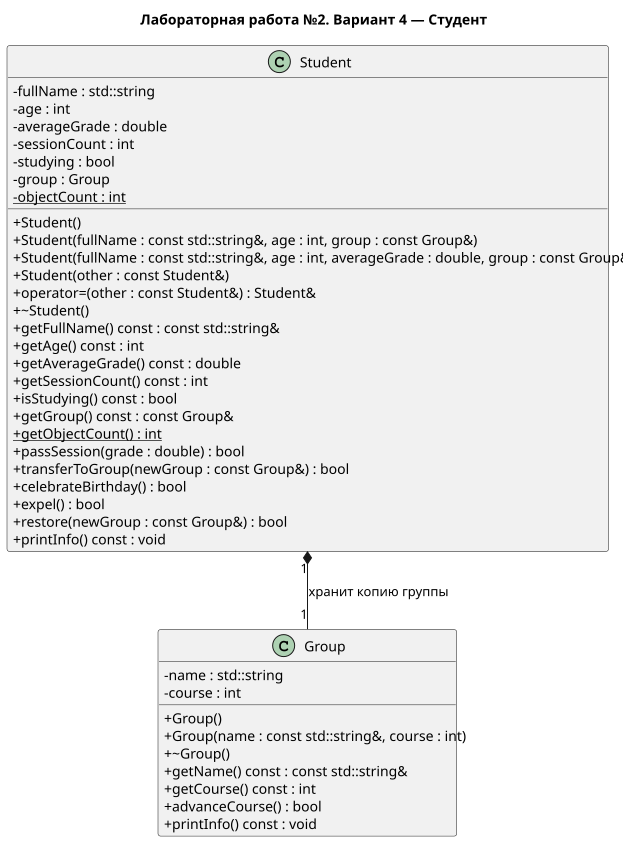

# Лабораторная работа №2

## Описание

Вариант 4 — Студент (`Student`)

Программа моделирует студента и его учебную группу с помощью классов C++

Стандарт языка: C++14

Документация к коду создаётся с помощью Doxygen

UML-диаграмма создаётся с помощью PlantUML

## Документация

- [Проектирование классов](pages/design.md)
- [Требования работы](pages/requirements.md)
- [Результат работы](pages/result.md)
- [Объяснение кода](pages/explanation.md)
- [UML-диаграмма](uml/student.puml)

У `Student` все поля закрытые. Группа хранится отдельным объектом класса `Group`

В `main()` проверяются создание, правильные и неправильные действия, независимость студентов и счетчик объектов. Если проверки прошли, программа выводит `Количество ошибок: 0` и возвращает код 0

## Сборка программы

Для сборки используется файл `build.bat`. Нужен компилятор `g++` в PATH

```powershell
.\build.bat
.\build\lab2.exe
```

## Создание документации

```powershell
.\docs.bat
```

Открыть файл `docs/html/index.html`

Файл `docs.bat` запускает Doxygen и копирует UML-диаграмму в документацию. Нужен установленный Doxygen

## UML-диаграмма

Исходный файл: `uml/student.puml`

Для создания картинки можно открыть файл в редакторе с PlantUML или выполнить команду, если установлены Java и `plantuml.jar`:

```powershell
java -jar plantuml.jar -tsvg uml/student.puml
```

Готовая диаграмма: [student.svg](uml/student.svg)



## Этапы работы

Каждый законченный этап сохраняется отдельным коммитом и меткой:

- `stage1-design` — описание классов и условий корректности
- `stage2-group` — класс учебной группы и его проверка
- `stage3-student` — класс студента и основные действия
- `stage4-complete` — полная проверка, результаты и документация

